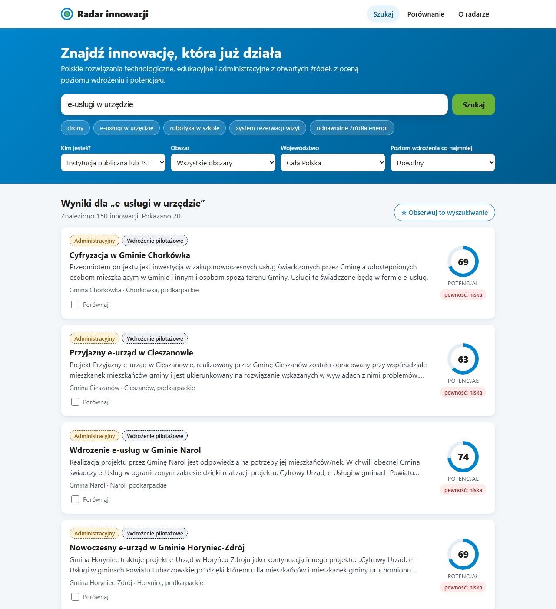

# Radar innowacji

Jedno miejsce do odkrywania istniejących polskich innowacji: technologicznych, edukacyjnych i administracyjnych. Radar sam znajduje je w otwartych źródłach, ocenia ich rzeczywisty poziom rozwoju według jawnych kryteriów i pokazuje, gdzie i przez kogo mogą zostać zastosowane.

Projekt powstał w ramach zadania Podkarpackiego Centrum Innowacji (PCI) na HackNation 2026 (Bydgoszcz, 21–22 listopada 2026).

## Spis treści

1. [Problem](#problem)
2. [Rozwiązanie](#rozwiązanie)
3. [Jak to działa](#jak-to-działa)
4. [Główne funkcje](#główne-funkcje)
5. [Zrzuty ekranu](#zrzuty-ekranu)
6. [Uruchomienie](#uruchomienie)
7. [Źródła danych](#źródła-danych)
8. [Kryteria oceny](#kryteria-oceny)
9. [Założenia i ograniczenia](#założenia-i-ograniczenia)
10. [Skalowanie na wiele organizacji](#skalowanie-na-wiele-organizacji)
11. [Bezpieczeństwo i ochrona danych](#bezpieczeństwo-i-ochrona-danych)
12. [Integracja z istniejącymi systemami](#integracja-z-istniejącymi-systemami)
13. [Rozwój po hackathonie](#rozwój-po-hackathonie)
14. [Licencja](#licencja)
15. [Licencje komponentów](#licencje-komponentów)

## Problem

W Polsce powstaje wiele innowacji, które już działają, ale pozostają mało znane. Informacje o nich są rozproszone w wielu miejscach:

- w wykazach projektów unijnych,
- w bazach patentów i projektów badawczych uczelni,
- na stronach urzędów, szkół i uczelni,
- w wynikach konkursów i w lokalnych mediach.

Istniejące katalogi wymagają ręcznego zgłaszania i zwykle obejmują jeden sektor. Gmina, która szuka rozwiązania, nie wie, że inna gmina już je wdrożyła. Inwestor nie widzi technologii z uczelni, które są gotowe do użycia. Szkoła nie wie, które metody nauczania sprawdziły się w innych szkołach.

## Rozwiązanie

Radar innowacji to aplikacja internetowa, która:

1. przeszukuje polskie otwarte źródła: API, zbiory danych i strony WWW;
2. automatycznie zbiera i porządkuje dane o każdej innowacji;
3. rozpoznaje obszar (technologiczny, edukacyjny, administracyjny) i typ innowacji;
4. ocenia poziom wdrożenia i dojrzałość według pięciu jawnych kryteriów;
5. pozwala wyszukiwać, filtrować i porównywać innowacje;
6. pokazuje każdą innowację jako przejrzystą kartę ze źródłami;
7. regularnie aktualizuje bazę.

Definicja innowacji pochodzi z Podręcznika Oslo 2018 (OECD/Eurostat): nowe lub ulepszone rozwiązanie, które istotnie różni się od wcześniejszych i jest dostępne dla użytkowników lub wdrożone w praktyce.

Radar **nie jest** platformą zgłaszania pomysłów, portalem społecznościowym, platformą crowdfundingową ani narzędziem do pozyskiwania inwestorów.

### Co wyróżnia radar

- **Automatyczne odkrywanie** z wielu polskich źródeł w jednym indeksie, bez ręcznego zgłaszania.
- **Dane ze źródła oddzielone od wartości przybliżonych.** Wartość ze źródła ma cytat i link. Wartość przybliżona ma etykietę „przybliżone” i powód.
- **Jawna, powtarzalna ocena.** Wynik pokazuje przedział, poziom pewności i wersję kryteriów. Ten sam rekord zawsze daje ten sam wynik.
- **Wynik to przedział, nie fałszywa precyzja.** Brak danych nie oznacza zera. Karta pokazuje, czego brakuje.
- **Sygnały popytu.** Karta pokazuje instytucje publiczne, które w ostatnich 180 dniach ogłosiły zamówienie o podobnym przedmiocie (BZP). Dopasowanie liczy wagi rzadkich wspólnych słów (IDF) i pokazuje te słowa. To przybliżenie, nie potwierdzony zakup tej innowacji.
- **„Czy to już istnieje?”** Użytkownik opisuje potrzebę własnymi słowami i dostaje podobne, istniejące rozwiązania.

## Jak to działa

```
Źródła ──► Odkrywanie ──► Rekord ──► Klasyfikacja ──► Ocena ──► Karta ──► Wyszukiwanie
  ▲                                                                            │
  └──────────────────────── Regularna aktualizacja ◄───────────────────────────┘
```

1. **Odkrywanie.** Moduły źródeł pobierają rekordy ze zbiorów danych i API. Moduły stron WWW (wyniki konkursu „Innowacyjny Samorząd”, lista sukcesów NCBR) czytają wybrane strony, przestrzegają `robots.txt` i przerw między zapytaniami.
2. **Rekord.** Każdy rekord trafia do jednego schematu danych. Dane osobowe są usuwane.
3. **Klasyfikacja.** Reguły przypisują obszar i typ na podstawie słów kluczowych i rodzaju źródła.
4. **Ocena.** Moduł reguł (`src/criteria.py`) liczy pięć kryteriów i potencjał w skali 0–100.
5. **Karta.** Strona pokazuje kartę z opisem, obszarem zastosowania, źródłami, statusem wdrożenia, poziomem gotowości i oceną potencjału.
6. **Użycie.** Użytkownik wpisuje frazę, filtruje wyniki i porównuje karty.
7. **Aktualizacja.** Zadanie cykliczne (`python -m src.pipeline update`) ponownie sprawdza źródła, zapisuje datę sprawdzenia, usuwa rekordy, których źródło już nie podaje, i łączy rekordy różnych źródeł o tej samej innowacji.

Indeks powstaje z wyprzedzeniem. Dlatego wyszukiwanie działa w kilka sekund, nawet gdy źródło jest chwilowo niedostępne.

## Główne funkcje

- **Wyszukiwarka z rekomendacjami.** Wyniki są sortowane według trafności (70%) i potencjału (30%). Wyszukiwanie pełnotekstowe (SQLite FTS5, BM25) działa na polskich lematach (simplemma), więc znajduje też odmienione formy słów („śmigłowiec” znajduje „śmigłowców”). Karta, która zawiera wszystkie słowa zapytania, jest wyżej niż karta z jednym popularnym słowem (trafność = pokrycie zapytania² × BM25). Wyszukiwanie semantyczne (embeddingi) to plan po hackathonie.
- **Filtry:** grupa użytkowników, obszar, województwo, minimalny poziom wdrożenia. Widok startowy to województwo podkarpackie, a wyszukiwanie obejmuje całą Polskę.
- **Karta innowacji:** opis, obszar i typ, instytucja i region, status wdrożenia, TRL (jeśli dotyczy), ocena z przedziałem i pewnością, każde kryterium z wagą, źródła z datami i licencjami, oś czasu sygnałów, sygnały popytu, podobne innowacje.
- **Gdzie można zastosować i kto może wdrożyć:** sektory z cytatem ze źródła, grupy odbiorców, instytucje z podobnymi rozwiązaniami (możliwi partnerzy lub kolejni odbiorcy) i rekomendowana ścieżka (transfer technologii, wdrożenie rynkowe, replikacja w innej instytucji, pilotaż z ewaluacją, uzupełnienie danych) z uzasadnieniem i miernikami skuteczności. Reguły są w `src/applications.py` (wersja v0.1).
- **Eksport CSV** wyników wyszukiwania (`/api/export.csv`) z oceną, pewnością, wersją kryteriów i linkami do źródeł.
- **Łączenie źródeł:** po każdej aktualizacji radar łączy rekordy różnych źródeł o tej samej innowacji (ta sama instytucja i podobny tytuł). Karta dostaje wtedy wszystkie źródła i wspólną oś czasu, np. grant z 2017 r., zgłoszenie patentowe z 2022 r. i patent z 2025 r. Dwa niezależne źródła podnoszą wiarygodność (K5) do 4. Ten sam projekt w dwóch źródłach (np. RAD-on i lista FE) to jedna karta.
- **Porównanie** 2–4 kart w tabeli kryteriów.
- **Obserwowane zapytania:** zapisane wyszukiwanie pokazuje „Nowe od ostatniej wizyty”. Zapis odbywa się tylko w przeglądarce, bez logowania.
- **Status źródeł:** aplikacja pokazuje, które źródło nie odpowiedziało i kiedy było ostatnio sprawdzone.

### Grupy użytkowników

Wybór grupy nie ukrywa wyników. Najpierw pokazuje obszar grupy, a karty, które spełniają warunek grupy, dostają +0,1 do wyniku rankingu. Trafność dalej decyduje o kolejności (`src/search.py`, `group_bonus`).

| Grupa | Typowe pytanie | Obszar pokazywany najpierw | Warunek bonusu |
|---|---|---|---|
| Inwestorzy i firmy | Które polskie technologie są gotowe do użycia? | technologiczny | TRL ≥ 6 lub poziom wdrożenia ≥ 4 |
| Instytucje publiczne i JST | Czy inna gmina już rozwiązała ten problem? | administracyjny | poziom wdrożenia ≥ 4 (karta pokazuje też zamówienia z BZP) |
| Uczelnie i jednostki naukowe | Kto pracuje nad podobnym tematem? | wszystkie | instytucja to uczelnia lub instytut |
| Szkoły | Które metody nauczania działają w innych szkołach? | edukacyjny | wiarygodność ≥ 4 |
| Startupy | Czy mój pomysł jest nowy? | technologiczny | innowacyjność ≥ 3 (nowe w Polsce lub szerzej) |
| Innowatorzy indywidualni | Czy podobny wynalazek już istnieje? | technologiczny | patent lub wzór użytkowy |

## Zrzuty ekranu

Zrzuty pokazują prawdziwe dane z bazy zbudowanej poleceniem `src.pipeline update` (22.11.2026).

| Widok | Plik |
|---|---|
| Wyszukiwanie „e-usługi w urzędzie” dla grupy „instytucje publiczne i JST” | [01-wyszukiwanie.png](docs/screenshots/01-wyszukiwanie.png) |
| Karta innowacji administracyjnej: ocena, gdzie zastosować, ścieżka z miernikami, zamówienia innych gmin | [02-karta-administracyjna.png](docs/screenshots/02-karta-administracyjna.png) |
| Karta innowacji technologicznej z uczelni: dwa źródła, oś czasu grant → patent | [03-karta-technologiczna.png](docs/screenshots/03-karta-technologiczna.png) |
| Porównanie trzech innowacji z różnych obszarów | [04-porownanie.png](docs/screenshots/04-porownanie.png) |
| „O radarze”: stan źródeł i jawne kryteria oceny | [05-o-radarze.png](docs/screenshots/05-o-radarze.png) |



## Uruchomienie

Wymagania: [uv](https://docs.astral.sh/uv/getting-started/installation/).

W katalogu głównym repozytorium:

```bash
uv venv --python 3.13 .venv
uv pip sync --python .venv requirements.txt
uv run --no-project python -m src.pipeline update --voivodeship podkarpackie
uv run --no-project uvicorn src.app:app --reload
```

Krok `src.pipeline update` pobiera dane ze wszystkich źródeł i buduje bazę `data/cache/radar.db` (ok. 30 MB). Pierwsze uruchomienie trwa ok. 20 minut, bo radar czyta strony z przerwami wymaganymi przez serwisy (NCBR ok. 8 min, Kohesio ok. 9 min, ogłoszenia BZP ok. 2,5 min, strony konkursu 60 s między stronami). Kolejne uruchomienia korzystają z pamięci podręcznej stron (7 dni) i trwają ok. 4 minut. Jedno źródło można odświeżyć osobno, np. `--source epo`. Bez parametru `--voivodeship` duże źródła (RAD-on, lista FE, Interreg) obejmują całą Polskę; listy ogólnopolskie (NCBR, EPO, Kohesio, konkursy) radar czyta zawsze w całości. Ten sam krok, uruchamiany cyklicznie (np. przez cron), aktualizuje bazę.

Aplikacja działa pod adresem http://127.0.0.1:8000. Użytkownik nie potrzebuje konta ani klucza API.

Testy:

```bash
uv run --no-project python -m pytest
uv run --no-project python -m pytest -m slow
```

Pierwsze polecenie nie potrzebuje sieci: używa nagranych odpowiedzi źródeł i stałych przypadków z `tests/cases.json` (obszar, poziom wdrożenia, TRL, przedział oceny, sektory i ścieżka). Drugie polecenie przechodzi cały proces z siecią: pobranie ze źródła, ocena, indeks, wyszukiwanie i karta. Sprawdza też, że karta nowej innowacji powstaje w 30 sekund lub szybciej.

### Demonstracja (dwa przypadki użycia, zadanie, sekcja 6)

Przed pokazem zbuduj bazę (`src.pipeline update`). Potem aplikacja działa bez sieci, bo wyszukiwanie korzysta tylko z lokalnej bazy `data/cache/radar.db`.

1. **Technologia z uczelni dla firmy.** Wpisz „śmigłowiec” lub „rehabilitacja”. Radar pokazuje patenty uczelni z Podkarpacia. Karta pokazuje:
   - poziom wdrożenia i TRL z etykietą „przybliżone” i powodem;
   - ocenę według 5 kryteriów z przedziałem i pewnością;
   - sektory zastosowania z cytatem ze źródła;
   - instytucje z podobnymi rozwiązaniami;
   - ścieżkę „Transfer technologii” z miernikami skuteczności.
2. **Rozwiązanie z innej gminy dla urzędu.** Wybierz „Kim jesteś? → instytucje publiczne i samorządy” i wpisz „e-usługi w urzędzie”. Radar pokazuje wdrożone rozwiązania JST. Karta pokazuje ścieżkę „Replikacja w innej instytucji” z miernikami: liczba instytucji, które przejęły rozwiązanie, liczba użytkowników i efekt w nowym miejscu.

## Źródła danych

Wszystkie źródła są bezpłatne i nie wymagają klucza API. Aplikacja zapisuje licencję każdego źródła oraz datę danych i datę pobrania. Aktualny stan źródeł zwraca `GET /api/sources`.

| Źródło | Zawartość | Dostęp | Licencja | Obszar |
|---|---|---|---|---|
| Lista projektów FE 2021–2027 (dane.gov.pl) | ok. 36 500 projektów z opisem, beneficjentem i lokalizacją | XLSX | CC0 1.0 | wszystkie |
| Strony WWW instytucji (crawler) | aktualności i projekty szkół, JST, uczelni, inkubatorów, wyniki konkursów | HTTP, `robots.txt` | tylko krótkie streszczenie i link (TDM, art. 26³ pr. aut.) | wszystkie |
| RAD-on, dane otwarte (OPI PIB) | patenty jednostek naukowych, projekty badawcze | REST JSON | CC0 1.0 | technologiczny, edukacyjny |
| Ogłoszenia BZP (e-Zamówienia) | zakupy instytucji publicznych (sygnały popytu) | REST JSON | wolne użycie | sygnał popytu |
| Wyniki konkursu „Innowacyjny Samorząd” (Serwis Samorządowy PAP, strony wartowiedziec.pl) | laureaci i wyróżnieni: wdrożone projekty JST z całej Polski | HTML, `robots.txt` (Crawl-delay 60 s) | prawa wydawcy; zapisujemy krótki cytat i link | administracyjny |
| NCBR, „Wyszukiwarka sukcesów beneficjentów” | ok. 310 zakończonych projektów z opisem problemu i odbiorców | HTML (lista i strony projektów), `robots.txt` zezwala | niepodana; zapisujemy opis z linkiem | technologiczny, edukacyjny |
| Interreg 2021–2027 zarządzane przez Polskę (dane.gov.pl, zbiór 15971) | ok. 100 projektów transgranicznych z rozwiązaniem (system, platforma, metoda) | XLSX | CC0 1.0 | technologiczny, administracyjny |
| Kohesio (Komisja Europejska) | zakończone projekty UE 2014–2020 w Polsce: e-usługi, systemy, pracownie, aplikacje | JSON API bez klucza (nieudokumentowane) | brak podanej licencji; zasady ponownego wykorzystania treści KE (decyzja 2011/833/UE), założenie | wszystkie |
| EPO Linked Open Data (Europejski Urząd Patentowy) | ok. 1160 patentów europejskich udzielonych polskim firmom, uczelniom i instytutom w ostatnich 5 latach | SPARQL bez klucza (`robots.txt` zezwala) | CC BY 4.0 | technologiczny |

Lista projektów FE: aktualizacja pobiera najnowszy miesięczny plik XLSX ze zbioru 13939 na dane.gov.pl do `data/cache/`. Gdy API nie odpowiada, wystarczy pobrać plik ręcznie i zapisać go jako `data/cache/fe_<id zasobu>.xlsx`. Radar zostawia projekty z sygnałem innowacji: kategoria wsparcia B+R, innowacji lub TIK albo słowo „innowac”, „e-usług” itp. w tytule. Nazwy beneficjentów, którzy są osobami fizycznymi lub przedsiębiorcami indywidualnymi, są ukryte. Opisy pochodzą z wniosków, dlatego poziom wdrożenia wynika z dat projektu.

NCBR: radar czyta listę sukcesów i strony projektów. Z każdej strony bierze tylko sekcje „Jaki problem rozwiązuje nasz projekt?” i „Kto korzysta/skorzysta z wyników projektu?”. Nie bierze sekcji o zespole. Beneficjentów, którzy są osobami fizycznymi, radar pomija, a zdania z tytułami naukowymi i nazwiskami usuwa. Lista jest mała i ogólnopolska, dlatego radar wczytuje ją w całości, także przy filtrze województwa. Pierwsze pobranie trwa ok. 8 minut (przerwa 1,5 s między stronami), kolejne korzystają z pamięci podręcznej przez 7 dni.

Kohesio: radar szuka kilku polskich fraz („innowacyjny”, „e-usługi”, „wdrożenie systemu”, „pracownia”, „aplikacja”) i bierze tylko projekty zakończone. Zakończony projekt z lat 2014–2020 to rozwiązanie, które już istnieje, np. e-Zamówienia albo e-Doręczenia. API nie ma dokumentacji, dlatego radar zapisuje odpowiedzi w pamięci podręcznej i przy błędzie korzysta z pozostałych źródeł.

EPO: radar pobiera patenty europejskie (B1) zgłaszających z adresem w Polsce. Dane nie podają miasta, dlatego karta nie ma województwa. Tytuły są po angielsku; polskie słowa kluczowe pochodzą z sekcji klasyfikacji IPC (np. „elektrotechnika, energetyka, elektronika”), więc karty znajdzie też polskie zapytanie. Radar bierze tylko zgłaszających, którzy są wyraźnie instytucjami (forma prawna spółki, uczelnia, instytut, centrum itp.). Osoby fizyczne i firmy jednoosobowe z imieniem i nazwiskiem pomija.

Erasmus+ (platforma wyników projektów) odpowiada kodem 403 na zapytania automatyczne, dlatego radar jej nie używa.

CORDIS (projekty programu Horyzont Europa, wskazane w FAQ) radar na razie pomija: plik `robots.txt` serwisu cordis.europa.eu zabrania automatycznego pobierania katalogu `/data/` z plikami zbiorczymi. Po hackathonie plik można pobierać ręcznie albo przez data.europa.eu.

Interreg: plik ma te same pola co lista FE, dlatego radar stosuje te same reguły obszaru, poziomu wdrożenia i ukrywania osób fizycznych. Partner wiodący może być za granicą; wtedy karta nie ma województwa.

Wyniki konkursów: adresy stron wyników są w `data/web_sources.csv` (kategoria `competition_results`), nie w kodzie. Radar tworzy jedną kartę dla każdego nagrodzonego lub wyróżnionego projektu. Laureatem jest JST, nie osoba. Nagroda jury to publiczne potwierdzenie wdrożenia, dlatego poziom wdrożenia i wiarygodność są faktami z cytatem. Strony innych konkursów z listy (np. „Kierunek innowacja”) podają tylko nazwiska nauczycieli bez opisu innowacji, a PARP blokuje automatyczne pobieranie, dlatego radar ich nie używa.

Pełna lista źródeł, kolejność integracji i źródła wykluczone (z powodami) są w `docs/project.md`, sekcja 6.

### Dane przykładowe

Dane przykładowe (`tests/fixtures/sample_innovations.json`, 18 rekordów) pochodzą z publicznych źródeł, pobranych 22.11.2026. Nie zawierają danych osobowych: aplikacja pomija nazwiska wynalazców i autorów. Korzystają z nich tylko testy; aplikacja pokazuje dane z bazy zbudowanej ze źródeł.

| Źródło | Zawartość | Licencja i sposób użycia |
|---|---|---|
| [RAD-on (OPI PIB)](https://radon.nauka.gov.pl/opendata/polon/products), API `products` | patenty uczelni | CC0 1.0 |
| [NCBR: Wyszukiwarka sukcesów beneficjentów](https://www.gov.pl/web/ncbr/wyszukiwarka-sukcesow-beneficjentow) | opisy zrealizowanych projektów | licencja nie jest podana; zapisujemy krótkie cytaty i link |
| [wartowiedziec.pl](https://wartowiedziec.pl) | laureaci konkursu „Innowacyjny Samorząd”, usługa „Mobilny Urzędnik” | prawa wydawcy; zapisujemy krótkie cytaty i link |
| [polishscience.pl](https://www.polishscience.pl) | projekt RoboLAB | prawa wydawcy; zapisujemy krótkie cytaty i link |

## Kryteria oceny

Pięć kryteriów odpowiada wymaganiom zadania PCI. Wagi i skale są propozycją zespołu w wersji **v0.1**. Wymagają kalibracji z mentorami PCI. Wszystkie kryteria, skale, wagi i odwołania są w jednym module: `src/criteria.py`.

| ID | Kryterium | Skala | Waga | Odwołanie |
|---|---|---|---|---|
| K1 | Poziom wdrożenia | 1 koncepcja, 2 prototyp, 3 testy, 4 wdrożenie pilotażowe, 5 stosowane w praktyce | 30 | Podręcznik Oslo 2018 |
| K2 | Dojrzałość technologiczna | TRL 1–9; „nie dotyczy” dla innowacji nietechnologicznych | 15 | definicja TRL programu Horyzont (KE) |
| K3 | Innowacyjność | 1 nowe w instytucji, 2 w regionie, 3 w Polsce, 4 w Europie, 5 na świecie | 20 | Podręcznik Oslo 2018 (stopień nowości) |
| K4 | Potencjał zastosowania | 0–5 pkt: dokumentacja dla innych, znany koszt, brak specjalnej infrastruktury, więcej niż jeden sektor, sygnały popytu (BZP) | 20 | Interreg Europe (dobre praktyki); Rogers (atrybuty dyfuzji) |
| K5 | Wiarygodność | 0 brak danych, 1 deklaracja własna, 2 opis z liczbami, 3 jedno weryfikowalne źródło, 4 dwa niezależne źródła, 5 publiczne potwierdzenie wdrożenia | 15 | Nesta Standards of Evidence |

Dlaczego te wagi: zadanie akcentuje rzeczywisty poziom rozwoju, a definicja z Podręcznika Oslo wymaga wdrożenia, dlatego K1 ma największą wagę. TRL nie dotyczy innowacji edukacyjnych i administracyjnych, dlatego K2 ma małą wagę.

### Reguły

1. Każde kryterium ma skalę 0–5. TRL przelicza się tak: TRL 1–2 → 1, TRL 3–4 → 2, TRL 5–6 → 3, TRL 7–8 → 4, TRL 9 → 5.
2. Jeśli TRL nie dotyczy, waga K2 przechodzi proporcjonalnie na pozostałe kryteria.
3. Potencjał = Σ waga × wartość / 5, w skali 0–100.
4. Brak danych to nie zero. Wynik ma przedział: dolna granica przyjmuje 0 dla nieznanych kryteriów, górna granica 5. Wartość punktowa uwzględnia tylko znane kryteria.
5. Pewność oceny zależy od udziału wagi opartej na faktach: wysoka od 70%, średnia od 40%, niska poniżej 40%.
6. Każda ocena zapisuje wersję kryteriów (na przykład „kryteria v0.1”).
7. K4 (potencjał zastosowania) radar szacuje danymi z kart: opublikowany opis patentowy (dokumentacja), wartość projektu w źródle (znany koszt), co najmniej dwa sektory zastosowania, zamówienia o podobnym przedmiocie w BZP (sygnały popytu). Warunku „nie wymaga specjalnej infrastruktury” źródła nie podają; radar go nie liczy i pisze to w uzasadnieniu. Wartość K4 to liczba spełnionych warunków, z etykietą „przybliżone” i listą warunków.
8. Dwa niezależne źródła tej samej innowacji podnoszą K5 do 4 (łączenie źródeł).

### Dane ze źródła i wartości przybliżone

Każde pole karty ma wartość, rodzaj („ze źródła” lub „przybliżone”), link do źródła i krótki cytat. Wartość przybliżona ma dodatkowo powód w jednym zdaniu. Aplikacja sprawdza, czy cytat jest częścią tekstu źródła.

Prototyp szacuje poziom wdrożenia i innowacyjność regułami słów kluczowych, bez modelu AI. Na przykład „wdrożono” i „stosowane” wskazują poziom 5, „pilotaż” poziom 4, a „pierwsze w Polsce” poziom 3 innowacyjności. Plan na przyszłość („zostanie wdrożony”) liczy się jako koncepcja. Model językowy może w przyszłości proponować wartości, ale nigdy nie będzie jedynym źródłem oceny.

## Założenia i ograniczenia

**Założenia**

- Użytkownikiem jest każda osoba, która szuka innowacji. Żadna grupa nie ma pierwszeństwa.
- Widok startowy to województwo podkarpackie, a wyszukiwanie obejmuje całą Polskę.
- Radar ocenia innowację, nie osobę.
- Prototyp działa bez modelu językowego. Streszczenie to pierwsze zdania opisu ze źródła (cytat).

**Ograniczenia**

- Wagi v0.1 nie są jeszcze skalibrowane z ekspertami PCI.
- Wartości przybliżone z reguł słów kluczowych mogą się mylić. Dlatego mają etykietę „przybliżone” i powód.
- Część innowacji (zwłaszcza w szkołach i JST) jest opisana tylko na stronach instytucji. Radar znajduje je na razie przez wyniki konkursów i listy projektów. Ogólny crawler stron szkół i JST to plan: test na 29 stronach dał dużo szumu.
- Listy ogólnopolskie (konkursy, NCBR, Kohesio) nie zawsze podają województwo. Takie karty są widoczne przy filtrze „Cała Polska”.
- Sygnały popytu z BZP to dopasowanie po rzadkich wspólnych słowach. Część dopasowań jest przypadkowa, dlatego karta pokazuje wspólne słowa.
- Kohesio nie podaje licencji danych; radar przyjmuje zasady ponownego wykorzystania treści Komisji Europejskiej (decyzja 2011/833/UE) i pisze to przy źródle.
- Dane o wdrożeniach bywają nieaktualne. Karta pokazuje datę ostatniego sprawdzenia każdego źródła.
- Niektóre strony blokują roboty lub nie odpowiadają. Radar to respektuje i korzysta z pozostałych źródeł.

## Skalowanie na wiele organizacji

- **Brak danych instytucji w kodzie.** Region startowy, lista stron do crawlera i partnerzy są w konfiguracji i w bazie, nie w kodzie. Inne centrum innowacji uruchamia radar dla swojego regionu bez zmian w kodzie.
- **Jedno źródło to jeden moduł.** Nowe źródło dodaje się jako moduł w `src/sources/` z jedną funkcją, która zwraca rekordy i metadane: źródło, datę danych, datę pobrania i licencję.
- **Cała Polska od początku.** Wszystkie źródła (FE 2021–2027, RAD-on, BZP, NCBR, Interreg, Kohesio, EPO, „Innowacyjny Samorząd”) są ogólnopolskie.
- **Lekka infrastruktura.** Jedna baza SQLite z FTS5 i sqlite-vec, serwer FastAPI. Aplikacja działa na zwykłym serwerze lub laptopie, bez GPU i bez płatnych usług. Ciężkie obliczenia (embeddingi dużych zbiorów) mogą być wykonywane z wyprzedzeniem w osobnym zadaniu.
- **Wersjonowane kryteria.** Organizacja może skalibrować wagi. Każda ocena zapisuje wersję kryteriów, więc wyniki różnych wersji da się porównać.

## Bezpieczeństwo i ochrona danych

- **Bez logowania.** Wyszukiwanie i karty są dostępne bez konta. Użytkownik nie potrzebuje klucza API.
- **Bez danych osobowych.** Radar pobiera tylko dane o innowacji i instytucji. Ukrywa dane osobowe w pobranych zbiorach, na przykład nazwiska twórców w RAD-on i osoby fizyczne na liście projektów FE. Crawler nie zapisuje nazwisk uczniów ani nauczycieli.
- **Brak profilowania osób.** Ocena dotyczy innowacji, nie ludzi. Dzięki temu system nie jest systemem wysokiego ryzyka w rozumieniu AI Act (art. 6 ust. 3).
- **Legalne źródła.** Radar korzysta tylko z danych bezpłatnych i legalnych, zapisuje licencję każdego źródła, przestrzega `robots.txt` i warunków korzystania ze stron oraz ogranicza liczbę zapytań do jednego serwera. Ze stron WWW zapisuje tylko opis potrzebny do karty i link. Kopie stron trzyma w lokalnej pamięci podręcznej najwyżej 7 dni, żeby nie obciążać serwerów, a potem je usuwa.
- **Obserwowane zapytania tylko w przeglądarce.** Zapisane wyszukiwania są w `localStorage` użytkownika, nie na serwerze.
- **Sekrety poza repozytorium.** Ewentualne klucze są tylko w pliku `.env`, którego nie ma w repozytorium.
- **Anonimowa analityka (FAQ, sekcja 7).** Radar liczy tylko filtry wyszukiwań (obszar, grupa użytkowników, województwo, wyszukiwanie z frazą lub bez) i oglądane karty, w sumach dziennych. Nie zapisuje treści zapytań (mogłyby zawierać nazwisko), adresów IP, identyfikatorów ani ciasteczek. Wyniki: `GET /api/stats`.

## Integracja z istniejącymi systemami

- **JSON API:**
  - `GET /api/search?q=&area=&voivodeship=&level_min=&group=&limit=` – wyszukiwanie z filtrami;
  - `GET /api/innovations/{id}` – pełna karta z podobnymi innowacjami;
  - `GET /api/sources` – stan źródeł danych;
  - `GET /api/stats?days=30` – anonimowe liczniki: najczęstsze obszary, grupy, województwa i oglądane karty;
  - `GET /api/health` – stan aplikacji.
- **Eksport CSV:** `GET /api/export.csv?q=&area=&voivodeship=&level_min=&group=&limit=` – wyniki z oceną, pewnością, wersją kryteriów i linkami do źródeł, do arkusza lub systemu CRM (UTF-8, separator `;`).
- **Kryteria:** `GET /api/criteria` – nazwy, skale, wagi i źródła kryteriów oceny.
- **Otwarty schemat karty.** Każde pole zawiera wartość, rodzaj (ze źródła lub przybliżone), źródło i cytat, więc inne systemy mogą korzystać z danych bez utraty informacji o ich pochodzeniu.
- **Uzupełnienie, nie zastąpienie.** Radar może zasilać systemy PCI, regionalne katalogi dobrych praktyk i krajowe wyszukiwarki (na przykład Smart Radar) gotowymi kartami.

## Rozwój po hackathonie

1. Kalibracja wag i skal z mentorami i analitykami PCI.
2. Kolejne źródła: CORDIS (plik pobierany ręcznie lub przez data.europa.eu, bo `robots.txt` blokuje automat), lista wynalazków UPRP, OpenAlex, opisy patentów EPO, kolejne edycje konkursów, ogólny crawler stron szkół i JST z listy podmiotów BIP.
3. Wyszukiwanie semantyczne: embeddingi `sdadas/mmlw-roberta-base` (Apache-2.0) liczone z wyprzedzeniem.
4. Klasyfikacja i streszczenia przez otwarty model językowy (np. Bielik, Apache-2.0), wykonywane z wyprzedzeniem i oznaczone jako „przybliżone”.
5. Panel analityka PCI: potwierdzanie lub korekta wartości z zapisem powodu.
6. Powiadomienia e-mail o nowych kartach dla obserwowanych zapytań.
7. Historia statusu innowacji: zidentyfikowana, oceniona, pilotaż, wdrożona w kolejnej instytucji.
8. Mierniki skuteczności: czas znalezienia rozwiązania, odsetek kart z wysoką pewnością, pokrycie znanych laureatów konkursów.

## Licencja

Rozwiązanie jest przygotowane do publikacji na licencji [EUPL-1.2](https://interoperable-europe.ec.europa.eu/collection/eupl/eupl-text-eupl-12). Pełny tekst licencji jest w pliku [`LICENSE`](LICENSE).

## Licencje komponentów

Wszystkie komponenty mają licencje zgodne z EUPL-1.2.

| Komponent | Zastosowanie | Licencja |
|---|---|---|
| FastAPI, Starlette | serwer aplikacji i API | MIT, BSD-3-Clause |
| Uvicorn | serwer HTTP | BSD-3-Clause |
| httpx | zapytania do źródeł danych | BSD-3-Clause |
| Pydantic | schemat danych | MIT |
| openpyxl | odczyt plików XLSX | MIT |
| Beautiful Soup | analiza HTML | MIT |
| trafilatura | wyodrębnianie tekstu ze stron WWW | Apache-2.0 |
| Protego | obsługa `robots.txt` | BSD-3-Clause |
| SQLite (FTS5), sqlite-vec | baza danych i wyszukiwanie | domena publiczna, MIT / Apache-2.0 |
| simplemma | lematyzacja tekstu polskiego | MIT |
| certifi (zależność pośrednia httpx) | certyfikaty TLS | MPL-2.0 (używana bez zmian) |
| pytest, Ruff (tylko dla deweloperów) | testy i kontrola kodu | MIT |
| PptxGenJS, React, react-icons (tylko prezentacja) | generowanie slajdów `docs/presentation/` | MIT |
| sharp (tylko prezentacja) | przetwarzanie zrzutów ekranu i ikon | Apache-2.0 |
| Ikony Font Awesome Free (tylko prezentacja) | ikony na slajdach | CC BY 4.0 (© Fonticons, Inc.) |

Pełna lista pakietów z wersjami: `requirements.txt`.
